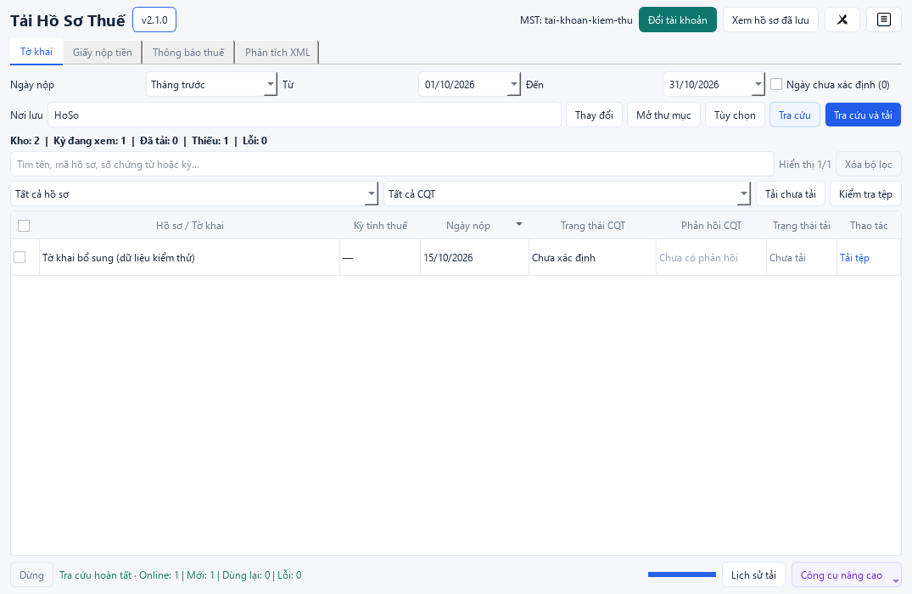

# Tải Hồ Sơ Thuế

Tra cứu, tải và quản lý hồ sơ thuế điện tử; đọc XML/ZIP và xuất Excel.
Bản Windows x64 chạy bằng một tệp EXE, không cần cài Python hoặc Excel.

**[Tải bản Windows mới nhất](https://github.com/dieutx/tai-ho-so-thue-gtgt/releases/latest/download/TaiHoSoThue-Windows.exe)** · [Các bản phát hành](https://github.com/dieutx/tai-ho-so-thue-gtgt/releases) · [Hướng dẫn Python/CLI](docs/CLI_GUIDE.md)

## Chức năng chính

- **Tra cứu và tải:** tờ khai, giấy nộp tiền, thông báo thuế và phản hồi đính kèm hồ sơ.
- **Quản lý hồ sơ:** lưu theo tài khoản, lọc theo kỳ, dùng lại tệp hợp lệ đã tải.
- **Phân tích offline:** đọc XML/ZIP, phân loại hồ sơ và xuất báo cáo Excel.

## Sử dụng trên Windows

1. Tải và mở `TaiHoSoThue-Windows.exe`.
2. Chọn **Doanh nghiệp** hoặc **Cá nhân**, bấm **Đăng nhập** và nhập tài khoản.
3. Chọn nhóm hồ sơ, khoảng ngày và nơi lưu; bấm **Tra cứu**.
4. Chọn hồ sơ → **Tải các tệp đã chọn** hoặc **Tải chưa tải**. Bấm **Xem file** để mở tệp đã tải.

**Tra cứu** chỉ lấy danh sách; **Tra cứu và tải** thực hiện cả hai bước.
CAPTCHA được đọc tự động tối đa 5 lần, sau đó chuyển sang nhập tay.

Để xử lý tệp có sẵn, chọn **Phân tích XML** → chọn XML/ZIP → chọn nơi xuất → chạy phân tích.
Chế độ này không cần tài khoản hoặc Internet.

Xem giao diện

## Dữ liệu và lưu ý

- Hồ sơ và cấu hình nằm ngoài EXE, tiếp tục được dùng khi cập nhật ứng dụng.
- Mật khẩu chỉ được lưu khi chọn **Lưu mật khẩu trên máy này**, qua Windows Credential Manager.
- **Trạng thái cơ quan thuế** và **trạng thái tải tệp** là hai thông tin riêng biệt.
- Tài khoản cá nhân hỗ trợ tờ khai và thông báo; **giấy nộp tiền cá nhân chưa được hỗ trợ**.
- Khi tải lỗi, chọn **Thử lại tệp lỗi**; mở **Nhật ký** để xem chi tiết. Tệp đã tải xong được giữ lại.

## Hướng dẫn và hỗ trợ

| Nhu cầu | Tài liệu |
|---|---|
| Cài đặt Python, cấu hình và dùng CLI | [Hướng dẫn Python/CLI](docs/CLI_GUIDE.md) |
| Build EXE từ mã nguồn | [Build Windows](BUILD_WINDOWS.md) |
| Vị trí lưu, nâng cấp và phục hồi dữ liệu | [Kho hồ sơ trên máy](docs/LOCAL_DATABASE_GUIDE.md) |
| Sử dụng tài khoản cá nhân | [Hướng dẫn cá nhân](docs/PERSONAL_ACCOUNTS.md) |
| Xem thay đổi và báo lỗi | [Changelog](CHANGELOG.md) · [GitHub Issues](https://github.com/dieutx/tai-ho-so-thue-gtgt/issues) |

Phần mềm bên thứ ba, không phải ứng dụng chính thức của cơ quan thuế. Giấy phép [MIT](LICENSE).
