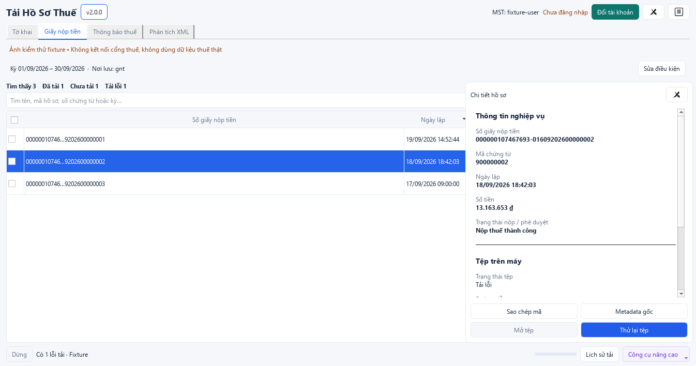

# Tải Hồ Sơ Thuế 2.1

Tra cứu và tải **tờ khai, giấy nộp tiền, thông báo thuế**; đọc XML/ZIP và xuất Excel.
Bản Windows x64 chạy bằng một file EXE, có CAPTCHA tự động, không cần cài Python hoặc Excel.

**[⬇ Tải bản Windows mới nhất](https://gitlab.com/dieutx/tai-ho-so-thue-gtgt/-/releases/permalink/latest/downloads/TaiHoSoThue-Windows.exe)** · [Xem các bản phát hành](https://gitlab.com/dieutx/tai-ho-so-thue-gtgt/-/releases)

**[🐍 Chạy bằng Python như trước — cài đặt, cấu hình .env và các lệnh CLI](docs/CLI_GUIDE.md)**

**[Mã nguồn trên GitHub](https://github.com/dieutx/tai-ho-so-thue-gtgt)**

*Ảnh giao diện mới với dữ liệu kiểm thử; không chứa hồ sơ thuế thật.*

## Dùng trong 4 bước

1. Tải và mở **TaiHoSoThue-Windows.exe**.
2. Chọn **Đăng nhập**, nhập tài khoản Thuế điện tử và mật khẩu; nhập CAPTCHA nếu được yêu cầu.
3. Chọn nhóm hồ sơ, khoảng ngày và nơi lưu, rồi bấm **Tra cứu**.
4. Chọn hồ sơ cần lấy → **Tải các tệp đã chọn**; hoặc bấm **Tải chưa tải**. Bấm **Xem file** để mở XML của hồ sơ bằng ứng dụng mặc định (ZIP gốc được giữ nguyên).

**Tra cứu & tải** lấy luôn hồ sơ trong khoảng đã chọn. Tệp hợp lệ đã có sẽ được dùng lại.
Kho hồ sơ được lưu bền vững trong SQLite theo tài khoản/nghiệp vụ. Đổi kỳ đọc ngay
dữ liệu local; tra cứu online bổ sung hồ sơ mới, không xóa các kỳ đã lưu. Có thể chọn
**Xem hồ sơ đã lưu** khi offline. Thanh chọn ngày luôn hiện và giữ kỳ đã chọn.
Chi tiết migration, vị trí DB và phục hồi: [Hướng dẫn kho local](docs/LOCAL_DATABASE_GUIDE.md).
CAPTCHA được thử tự động tối đa **5 lần**; nếu vẫn chưa thành công, app thông báo và mở ô nhập tay.
DVC được bật mặc định. **Trạng thái thuế** và **trạng thái tệp** được hiển thị riêng;
hồ sơ bị từ chối vẫn có thể đã tải thành công.

Khi danh sách bị thu hẹp bởi tìm kiếm hoặc bộ lọc, bấm **Xóa bộ lọc**
(`Ctrl+Shift+F`) để xem lại toàn bộ. Thanh chọn tệp cho biết có bao nhiêu tệp
đã chọn đang bị ẩn; **Tải các tệp đã chọn** lấy cả các tệp này.

Với hồ sơ DVC và legacy, app tải thêm **thông báo tiếp nhận / chấp nhận /
không chấp nhận** đính kèm hồ sơ (XML/PDF) vào
`thong-bao-dinh-kem/<mã hồ sơ>/` trong nơi lưu. Tệp đã có được bỏ qua; lỗi tải
thông báo không làm mất ZIP đã tải thành công và được báo riêng là chưa đầy đủ.
App không chặn ngày trước 01/01/2015; hỗ trợ XML cũ có DOCTYPE không ENTITY và
ZIP trả trực tiếp. Khả năng lấy được hồ sơ thực tế còn phụ thuộc dữ liệu/quyền
truy cập của cổng; chưa kiểm chứng hồ sơ thật trước 2015 trong bản sửa này.

## Đọc XML và xuất Excel

Chọn **Phân tích XML** → chọn hoặc kéo thả XML/ZIP → chọn nơi xuất → chạy phân tích.
Chế độ này không cần đăng nhập hay Internet. Báo cáo giữ các mẫu chưa hỗ trợ để kiểm tra tiếp.
Với danh sách tra cứu, chọn **Công cụ nâng cao → Xuất danh sách Excel…**.

Xem khung chi tiết hồ sơ

## Khi gặp lỗi

- Không ghi được tệp: đóng file Excel đang mở, chọn thư mục có quyền ghi; nếu dùng OneDrive, thử nơi lưu khác.
- Lỗi tải: bấm **Thử lại tệp lỗi**. Mở **Nhật ký** để xem chi tiết; tệp đã tải xong được giữ lại.
- Kiểm tra bản mới: app tự kiểm tra khi mở và hiện banner nếu có bản mới; bấm **v2.0.1** để xem phiên bản.

[Thay đổi phiên bản](CHANGELOG.md) · [Hướng dẫn CLI](docs/CLI_GUIDE.md) · [Build từ mã nguồn](BUILD_WINDOWS.md) · [Kết quả kiểm thử](docs/DESKTOP_ACCEPTANCE.md)

Phần mềm bên thứ ba, giấy phép [MIT](LICENSE). Không lưu mật khẩu tài khoản thuế vào cấu hình.

Bấm **MST** trên thanh đầu để chọn công ty đã đăng nhập và lưu trước đó.
Trong hộp đăng nhập, chọn/nhập MST; bật **Lưu mật khẩu trên máy này** để lưu
sau khi đăng nhập thành công. Mật khẩu nằm trong Windows Credential Manager
của người dùng Windows hiện tại, không nằm trong thư mục hồ sơ/settings.
Chọn **Quên tài khoản đã lưu** để xóa mật khẩu; **Đăng xuất** chỉ đóng phiên hiện tại.
