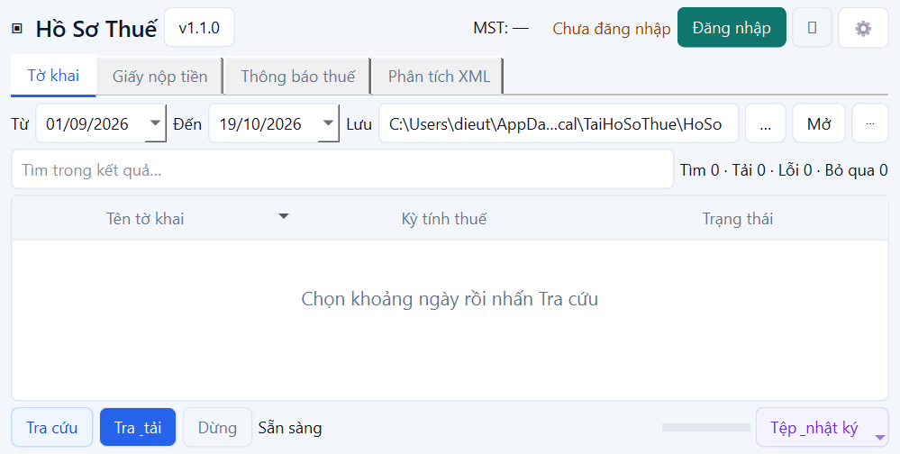

# Nghiệm thu desktop 1.1 — 19/10/2026

Đã build thực tế `dist/TaiHoSoThue-Windows.exe`, Full 1.1.0, Windows x64,
**88,256,580 B = 88.26 MB (84.17 MiB)**. Baseline 202,938,102 B;
giảm 56.51%, vẫn giữ OCR tự động.
Onefile/windowed, GUI subsystem 2, icon và version resource 1.1.0.0.

SHA-256:

```text
be8b860292caf5ef755a186db16da02870c5f3e7c1d7d51341abc89196a20a1a
```

Source/spec/scripts đầy đủ trong repo, không commit/push/publish tự động.
EXE chưa ký số. `dist/` chỉ có một EXE; hồ sơ thuế thật không được bundle.

## Thay đổi theo phản hồi thực tế

- DVC mặc định bật trên desktop, lưu lựa chọn trong Settings; CLI giữ tắt mặc
  định. Cookie DVC tách riêng ETAX. Khoảng qua cutoff giữ kết quả nguồn đã xong
  nếu nguồn kia lỗi.
- Tài khoản nhập một nơi; ETAX tái sử dụng phiên giữa các nhóm, chỉ xác thực lại
  tối đa một lần khi nhận dạng được hết phiên. HTTP 200 thiếu bảng/form dừng với
  lỗi rõ, không lặp sáu lần và không báo giả không có dữ liệu.
- WinError 5/32/33: retry thay tệp nguyên tử hữu hạn. Lỗi còn lại có hướng dẫn
  đóng Excel/tạm dừng OneDrive/chọn thư mục; giữ rows và tệp đã hoàn thành.
  Documents chuyển vào OneDrive thì mặc định ưu tiên LocalAppData; nơi lưu đã
  chọn vẫn được tôn trọng. Không khẳng định đã tái hiện đúng ACL của ảnh người dùng.
  Kiểm tra quyền ghi dùng probe hữu hạn, tránh vòng retry EACCES rất dài của
  tempfile Windows; báo cáo không được mở nếu lần flush cuối lỗi.
- Thêm màu cho thao tác, bảng luôn hiện, empty state, lỗi footer ngắn có nhật
  ký, trạng thái `Đã có hợp lệ`, ngày mặc định tháng trước; offline tách hàng khi hẹp.
- Mục phiên bản/build và kiểm tra cập nhật qua GitLab public releases chỉ chạy
  theo nút bấm. Repo riêng tư/chưa có release có thông báo rõ; không tự tải/cài.
- Tải nhiều nhóm tuần tự; mở/chuyển dữ liệu cũ; OCR bị từ chối chuyển sang nhập tay.

## Kết quả thực chạy

| Kiểm tra | Kết quả |
|---|---|
| Suite cuối | PASS: 433 test, 6 skip; 0 fail |
| Ruff / mypy core | PASS / PASS, 65 module |
| Một phiên ETAX | Mock integration Tờ khai → GNT → TB: đúng 1 login; hai thread tuần tự; đổi tài khoản xóa cookie/DSE |
| Đổi tab | 10 vòng qua bốn tab: giữ dữ liệu/filter, 0 login |
| Hết phiên | Invalidate + một lần relogin; vẫn hết hạn thì ERROR, không vòng lặp |
| HTTP 200 thiếu form TB | ERROR sau 1 query, không retry sáu lần và không báo empty |
| Ghi danh mục bị từ chối | Retry transient; lỗi vĩnh viễn hữu hạn; downloaded/rows/tệp được giữ |
| DVC lỗi trong khoảng hỗn hợp | PARTIAL, giữ kết quả legacy |
| CAPTCHA | Dialog manual không input; OCR bị từ chối bắt buộc nhập tay lần tiếp theo |
| Bảy entrypoint CLI / adapter | Fixture parity metadata/parsed/classification/Excel; dry-run không tạo file tải |
| Offline không mạng/credential | PASS; giữ NEED_MAPPING/UNKNOWN và các lần nộp |
| Hủy / controller | Giữ file và metadata đã commit, chặn Start hai lần, đóng app đợi worker |
| UI source / native EXE | PASS: 15 cấu hình mỗi loại, 4 nghiệp vụ, không outer QScrollArea |
| Frozen ×2 | PASS: thư mục Unicode chỉ EXE, offline 15 bản ghi/5 MAPPED, OCR+mapping có socket bị chặn |
| Bundle audit | PASS: 160 entry, 0 đường dẫn cấm, 0 secret khớp, 1 model ONNX, 5 mapping JSON |
| API cập nhật thật | HTTP 200, danh sách release rỗng; app báo chưa có bản công khai, không báo giả có cập nhật |
| Startup / RAM idle | Trung vị 4.072 s / 168,087,552 B; baseline 5.757 s / 167,301,120 B |
| Workflow offline + OCR | Hai frozen lượt PASS; so sánh thời gian baseline NOT RUN vì timeout 180 s, không công bố số không hợp lệ |

[Frozen lượt 1](desktop-evidence/1.1/report-1.json),
[lượt 2](desktop-evidence/1.1/report-2.json),
[audit](desktop-evidence/1.1/bundle-audit.json).
PARTIAL trong frozen fixture là đúng vì có mẫu chưa mapping, không đổi thành SUCCESS.
Build log: `.cache/optimization/build-1.1-final.log`. Source matrix:
`.cache/optimization/ui-1.1-final.txt`. Số đo: [BUILD_SIZE_REPORT.md](BUILD_SIZE_REPORT.md).

## Kiểm thử cổng thật (được người dùng yêu cầu)

Chạy bằng tài khoản local chỉ trong RAM, không in/ghi lại credential. Cấu hình
ngày 01/09/2025–25/10/2025; không proxy. Tải qua service/session manager thực,
không mock HTTP. Đây là kết quả tại thời điểm kiểm tra, không bảo đảm uptime lâu dài.

| Nhóm | Phát hiện | Tải hợp lệ | Lỗi | Thời gian |
|---|---:|---:|---:|---:|
| DVC | 5 | 5 | 0 | 36.859 s |
| GNT | 52 | 52 | 0 | 34.196 s |
| Thông báo | 5 | 5 | 0 | 4.812 s |

Khoảng thông báo đúng ảnh 01/06/2025–01/07/2025 trả 2 bản ghi. Chạy lại GNT/TB
giữ nguyên SHA-256 tệp; không ghi đè. Trong lượt tải có 2 POST ETAX login gồm
1 lần chưa được chấp nhận và 1 đăng nhập thành công, 1 POST DVC; các nhóm legacy
tiếp theo dùng cùng phiên. Test mock CAPTCHA hợp lệ đếm chính xác 1 login.

Offline trên tải thật: 57 dòng XML, 6 output, 0 lỗi parse, 53 unmapped,
trạng thái PARTIAL. Không suy diễn chỉ tiêu GNT hoặc nội dung PDF.
Hồ sơ/log live chỉ nằm trong `.cache/optimization/live` bị gitignore; tài liệu
chỉ ghi số tổng hợp, không đưa MST/số tiền/nội dung hồ sơ vào fixture/release.

## Ma trận giao diện

Trừ 40 physical px để mô phỏng taskbar, sau đó kiểm tra client và frame thực.
QT_SCALE_FACTOR đặt 1/1.25/1.5, Windows Qt backend; không đổi DPI Windows.
Ảnh diagnostic đặt ngày đến 19/10/2026 để thử phạm vi; app thật mặc định toàn bộ tháng trước.

| Màn hình tham chiếu | Scaling | Kết quả |
|---|---|---|
| 1920×1080 | 100%, 125%, 150% | PASS |
| 1366×768 | 100%, 125%, 150% | PASS |
| 1280×720 | 100%, 125%, 150% | PASS |
| 1024×768 | 100%, 125%, 150% | PASS |
| 1024×600 | 100%, 125%, 150% | PASS |



[Offline ở 150%](desktop-evidence/1.1/offline-1024x560-1.5.png).
Ảnh chỉ có fixture/trạng thái trống; check JSON và ảnh đủ ma trận ở evidence/1.1.

## NOT RUN / giới hạn

- VM Windows 10/11 sạch không Python/Qt/Excel: NOT RUN, không có máy sạch trong
  phiên; đã chạy standalone EXE trên máy build, không đánh đồng hai việc.
- Đổi màn hình/DPI vật lý, RDP, mọi taskbar: NOT RUN. Có test workarea/tọa độ âm.
- Tái hiện chính xác OneDrive ACL/Excel lock của máy người dùng: NOT RUN;
  đã test lỗi I/O/WinError và preservation bằng fault injection.
- Live sai mật khẩu/mất mạng, manual CAPTCHA qua GUI trên tài khoản thật:
  NOT RUN; các nhánh đó có mock/unit test. Portal thật được kiểm tra qua services.
- Request/inference/ghi tệp hiện tại chịu timeout hoặc phải hoàn tất trước khi
  dừng; không kill thread. Core giữ quy tắc metadata, không tự cộng/chọn lần nộp.
- Chưa ký Authenticode, chưa thử UPX, chưa build Lite. Chưa publish GitLab release;
  updater không được tuyên bố có bản mới nếu API không có release công khai.

Vận hành/build: [BUILD_WINDOWS.md](../BUILD_WINDOWS.md).
Mapping entrypoint: [UI_FUNCTION_MAPPING.md](UI_FUNCTION_MAPPING.md).
