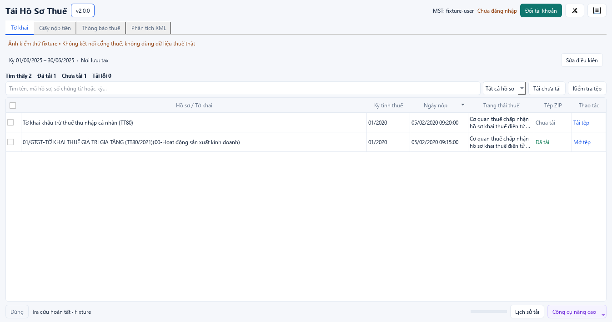
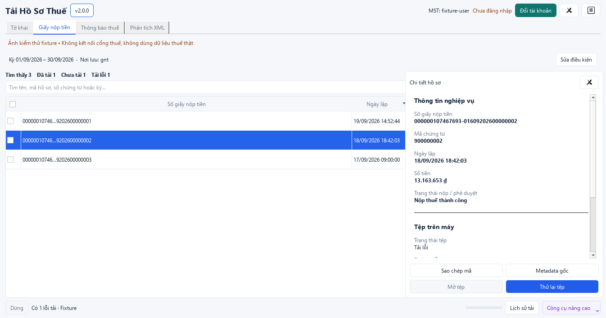

# Desktop 2.0

PySide6/Qt Widgets theo bộ thiết kế trong `design-v2`, gọi core Python in-process.
HTML prototype chỉ tham chiếu, không phải runtime.

```text
Tải Hồ Sơ Thuế [v2.0.0]                 MST / phiên / tài khoản / tùy chọn
[Tờ khai] [Giấy nộp tiền] [Thông báo thuế] [Phân tích XML]
Kỳ nhanh / Từ–Đến / Nơi lưu / Tra cứu / Tra cứu & tải
Tìm thấy / Đã tải / Chưa tải / Tải lỗi
Tìm kiếm / Lọc trạng thái tệp / Tải chưa tải / Kiểm tra tệp
Checkbox / QTableView / Thao tác từng hồ sơ / Khung chi tiết bên phải
Dừng / trạng thái / tiến độ / Lịch sử tải / Công cụ nâng cao
```

- Nền sáng, hành động chính xanh lam, tài khoản xanh ngọc, công cụ tím, lỗi cam/đỏ;
  trạng thái luôn có nhãn chữ. Một bảng cuộn nội bộ, không outer QScrollArea.
- Tra cứu xong thu gọn điều kiện; Sửa điều kiện mở lại. Kết quả giữ ngữ cảnh
  kỳ/tài khoản/nơi lưu gốc. Bộ lọc cục bộ không gọi mạng hoặc đổi bộ đếm tổng.
- Checkbox tiêu đề chọn các dòng đang hiện; drawer không làm mất tìm kiếm/scroll.
  Mã đầy đủ có tooltip, metadata và nút sao chép.
- Trạng thái thuế và tệp riêng biệt. Chỉ mở file hợp lệ hoặc folder tồn tại;
  file bị xóa không tiếp tục hiện đã tải. Ngày sort datetime, tiền dùng Decimal.
- Bốn tab giữ state riêng; cột thu gọn khi hẹp, đủ thông tin trong drawer/tooltip.
  Offline chọn hoặc kéo thả XML/ZIP/thư mục, không cần mạng hoặc tài khoản.
- Ctrl+F tìm, Ctrl+A chọn các dòng hiện, Space đổi chọn, Enter chi tiết, Esc đóng,
  Ctrl+L nhật ký, Ctrl+O thư mục, Ctrl+Enter tra cứu.
- QThread xử lý HTTP/OCR/I/O, dừng qua token. Lịch sử RAM tối đa 100 tác vụ;
  menu dữ liệu cũ đọc catalog đã lưu.

Native EXE có 18 cấu hình; sáu cấu hình thêm dữ liệu từ adapter/FakeHTTP, chặn
socket. Ảnh chỉ dùng fixture/trạng thái trống. [Nghiệm thu](DESKTOP_ACCEPTANCE.md).




