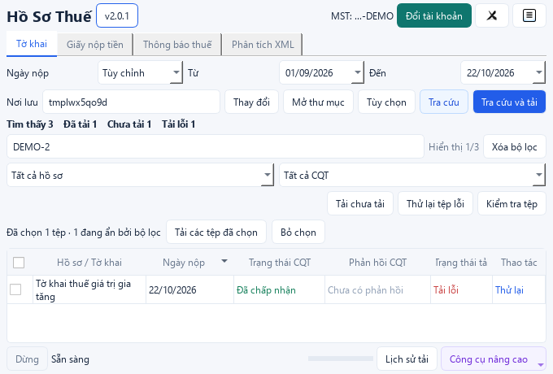

# Review code và trải nghiệm desktop — 22/10/2026

Baseline: `main` tại `39bbc1f`. Review và sửa trong worktree riêng, không đưa
thay đổi chưa commit của nhánh `feat/legacy-notices-pre2015` vào PR.

## Phạm vi

- Luồng khởi động, đăng nhập, đổi tài khoản, phiên ETAX/DVC và CAPTCHA.
- Tra cứu, chọn/lọc hồ sơ, tải riêng, kiểm tra tệp, chạy nhiều nhóm, hủy tác vụ.
- Nguồn XML/ZIP cục bộ, phản hồi CQT, xuất ZIP và báo cáo đối soát.
- Kiểm tra quyền sở hữu thư mục, xử lý lỗi, cấu hình, test/lint/typecheck và CI.
- Render Qt offscreen bốn tab ở 1024×680 và 680×460 với dữ liệu tổng hợp;
  kiểm tra thêm màn hình 1024×728 ở DPI 150% bằng `desktop.main --ui-check`.

Đây là review source và kiểm thử offline. Không dùng tài khoản thuế thật,
không gọi nghiệp vụ cổng thuế, không build/phát hành EXE trong đợt này.

## Các phát hiện đã sửa

| Mức | Phát hiện và ảnh hưởng | Thay đổi |
|---|---|---|
| Cao | Worker chuẩn bị thư mục nhóm batch ngoài `try`; lỗi ở nhóm sau làm mất tổng kết và danh sách của nhóm trước trong kết quả trả về. Tệp trên đĩa vẫn còn. | Bắt lỗi trong từng nhóm, giữ kết quả đã hoàn thành, trả `PARTIAL` và chạy nhóm tiếp theo. |
| Vừa | Sửa nguồn XML bằng bàn phím vẫn giữ `source_files` cũ; có thể xử lý sai tập tệp hoặc báo nguồn không hợp lệ. | Bỏ lựa chọn tệp cũ ngay khi sửa nguồn; cập nhật bộ đếm nguồn. |
| Vừa | `make_config()` có thể phát sinh lỗi quyền sở hữu/quyền truy cập ngoài callback xử lý lỗi của nút chạy. | Bắt lỗi chuẩn bị cấu hình, hướng dẫn chọn nơi lưu thuộc tài khoản hiện tại. |
| Vừa | Ngày đảo ngược/nguồn trống chỉ được phát hiện muộn; luồng online có thể hỏi đăng nhập trước khi báo ngày sai. | Kiểm tra điều kiện trước đăng nhập, thông báo cụ thể và focus ô cần sửa. |
| Vừa | Lựa chọn tải vẫn gồm hồ sơ bị lọc ẩn nhưng nhãn chỉ hiển thị tổng số. | Hiện số tệp đã chọn đang ẩn và tooltip giải thích phạm vi nút tải. |
| Vừa | Tìm kiếm cùng nhiều bộ lọc dễ làm người dùng tưởng mất hồ sơ; đổi riêng trạng thái tệp chưa xóa các bộ lọc khác. | Nút Xóa bộ lọc và `Ctrl+Shift+F`, giữ lựa chọn và trạng thái tab khác. |
| Vừa | Danh sách rỗng sau hủy/hoàn tất một phần bị ghi là không tìm thấy hồ sơ. | Hiện trạng thái chưa đủ dữ liệu để kết luận, hướng dẫn tra cứu lại/xem lịch sử. |
| Vừa | Workflow PR chỉ cài core nên bỏ qua các test Qt, không bắt được lỗi desktop. | Thêm job Windows với Qt Essentials 6.8.3, chạy toàn bộ suite trên mỗi PR. |
| Vừa | CI cài core bị lỗi import Qt từ phần logic XML/đối soát/cập nhật; bản cài sạch còn thiếu `packaging.version` cho kiểm tra cập nhật. | Tách `xml_content`, `release_info`, `feedback_labels` khỏi widget; khai báo dependency packaging. Các test logic vẫn chạy ở cấu hình core. |
| Thấp | Tìm kiếm, bộ lọc và nút tải dùng chung một hàng, chật hơn khi có nút thử lại/kiểm tra tệp. | Tách hàng tìm kiếm; chuyển bộ lọc/thao tác xuống hai hàng khi rộng dưới 850 px; giới hạn chiều rộng bộ lọc tên thông báo dài. |
| Thấp | `mypy` baseline lỗi ở `html_text.visible_text`, vì stack bị suy luận chỉ chứa `Tag`. | Khai báo stack `PageElement` và danh sách text rõ kiểu; giữ nguyên hành vi duyệt HTML. |



Ảnh sử dụng tài khoản và hồ sơ tổng hợp. Các nút lọc/tải vẫn hiển thị trong
cửa sổ 680×460; bảng dùng thanh cuộn riêng.

## Kiểm chứng

Baseline: 861 test đạt, 6 skip backend OCR tùy chọn; Ruff đạt, mypy có 2 lỗi
trong `html_text.py`. Môi trường đầy đủ dùng Windows/Python 3.11.15 và Qt 6.8.3.

Thêm 9 regression test kiểm tra trực tiếp luồng người dùng và worker batch:
xóa nhiều bộ lọc, giữ trạng thái tab khác và lựa chọn bị ẩn, sửa nguồn bằng
bàn phím, ngày sai trước đăng nhập, nguồn offline trống, xung đột quyền sở hữu,
kết quả rỗng chưa đầy đủ, giữ kết quả batch và bố cục có đủ các nút.

Hai lần chạy toàn bộ suite phát hiện test đối soát dọn thư mục tạm gặp
`WinError 145` sau khi ghi Excel trên Windows. Test này chuyển sang helper
retry có giới hạn đã dùng chung trong repo; helper chỉ retry mã 145, vẫn
báo lỗi khi file còn mở hoặc các lỗi khác.

Các lệnh xác minh:

```powershell
python scripts/run_test_gate.py --profile desktop
python -m ruff check .
python -m mypy gdt_tax tests/test_core_contracts.py
git diff --check
```

Kết quả sau sửa: **870 test đạt, 6 skip backend OCR tùy chọn**; gate desktop
đạt, Ruff đạt và mypy đạt 91 file. Kiểm tra DPI 150% không có control bị cắt
hoặc khung cửa sổ vượt vùng làm việc mô phỏng.

Qt offscreen không thay thế kiểm thử với màn hình vật lý, trình đọc màn hình
hoặc cổng thuế đang hoạt động. Job CI mới kiểm tra desktop mà không yêu cầu
tài khoản và không cài các backend OCR lớn.

## Hướng nâng cấp tiếp theo

1. Đo thời gian phản hồi khi danh sách hàng chục nghìn hồ sơ và cân nhắc cập
   nhật từng dòng thay vì reset model ở mỗi sự kiện tiến độ. Cần benchmark
   trước khi thay cơ chế selection/proxy để tránh lặp lại lỗi chỉ số cũ.
2. Bổ sung acceptance test màn hình vật lý với DPI 125%/150%/200%, bàn phím
   và trình đọc màn hình, đặc biệt khung phản hồi CQT và drawer chi tiết.
3. Ký số EXE trong quy trình release để người dùng nhận biết nhà phát hành.
   Công việc này cần chứng thư và cấu hình phát hành riêng.
