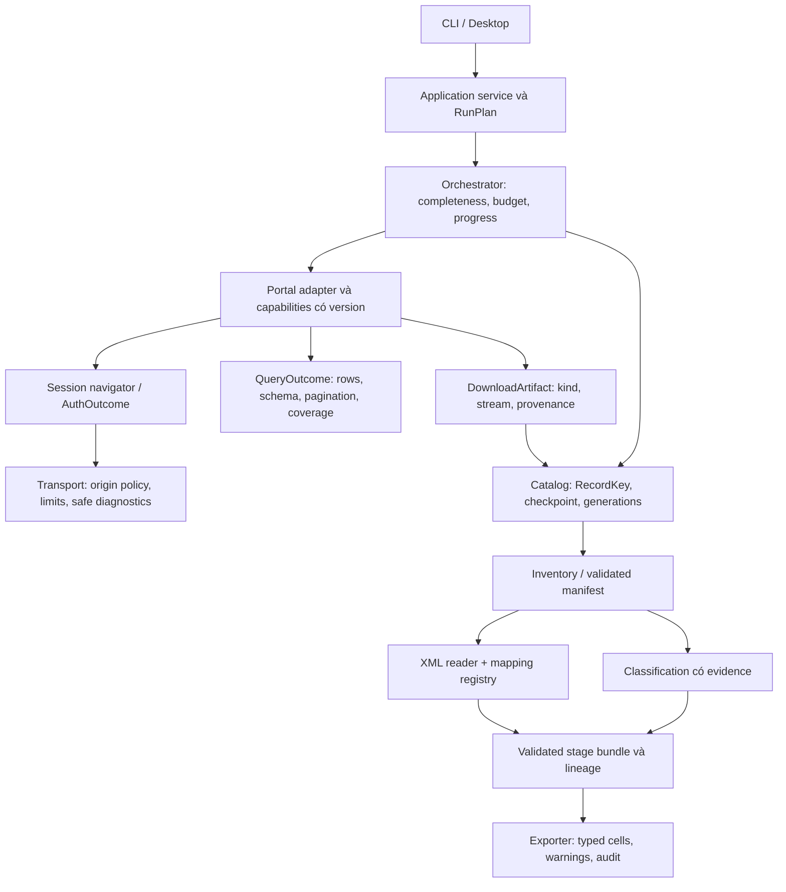
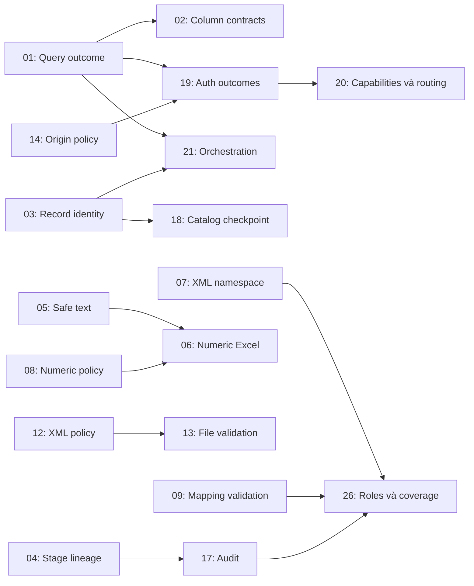

# Review core và kế hoạch PR — 20/10/2026

**Baseline:** `559892f1ff22f3e68d2fbea7be0608fd0ac597c9`, bản source tương ứng asset thay thế của desktop 2.0.0.

Review này đề xuất **26 đầu việc**, gồm **13 P1 và 13 P2**. Có **18 phép thử tổng hợp offline** minh họa cho 17 đầu việc; các mục còn lại là nhận xét từ code, khoảng trống kiểm thử hoặc đề xuất kiến trúc. Không có phát hiện P0 đã được chứng minh. Không suy ra dữ liệu thuế thực tế của người dùng đã bị sai hoặc có sự cố bảo mật đã xảy ra.

Khi tiếp tục review, có thêm phần source DVC/thông báo chưa commit. [Phụ lục worktree](WORKTREE_ADDENDUM.md) ghi riêng **4 ca bổ sung và 9 test liên quan đạt**, gắn kết quả với hash file thay vì commit baseline. Các ca bổ sung được ánh xạ vào ticket đã có, không sinh thêm ID trùng phạm vi.

Ưu tiên triển khai: **phát hiện kết quả thiếu/sai cấu trúc, định danh không gộp nhầm hồ sơ, ràng buộc dữ liệu giữa các stage, xuất báo cáo an toàn, rồi mới refactor để mở rộng**. Bộ test hiện có là nền tảng tốt, nhưng test xanh chưa chứng minh parser hiểu mọi biến thể mới của cổng.

## 1. Bộ tài liệu để giao việc

| Tệp | Dùng khi nào |
|---|---|
| [TASKS.md](TASKS.md) | Đọc chi tiết từng ID: vấn đề, code, phạm vi PR, tiêu chí nghiệm thu, ngoài phạm vi và phụ thuộc |
| [BACKLOG.json](BACKLOG.json) | Import vào công cụ quản lý hoặc giao agent bằng dữ liệu có cấu trúc |
| [AGENT_TASK_TEMPLATE.md](AGENT_TASK_TEMPLATE.md) | Copy prompt, chọn ID và yêu cầu agent tạo PR |
| [EVIDENCE.json](EVIDENCE.json) | Xem kết quả thật của 18 ca R01–R18 |
| [reproduce_findings.py](reproduce_findings.py) | Chạy lại các quan sát trên baseline bằng fixture tổng hợp |
| [SOURCE_MAP.json](SOURCE_MAP.json) | Tra 119 vị trí file/symbol/line và link source cố định theo baseline |
| [WORKTREE_ADDENDUM.md](WORKTREE_ADDENDUM.md) | Phần DVC/thông báo mới chưa commit: scope, 4 ca minh họa, nghiệm thu bổ sung và giới hạn |
| [WORKTREE_EVIDENCE.json](WORKTREE_EVIDENCE.json) | Hash source snapshot mới và kết quả W01–W04 |
| [VALIDATION.json](VALIDATION.json) | Phạm vi kiểm chứng và kết quả kiểm tra của lượt review |

Các ID là **đề xuất**, chưa tạo issue hoặc PR trên GitLab. Lượt này chỉ thêm tài liệu và script minh họa; không sửa production code, đổi EXE, đăng nhập cổng hoặc phát hành thêm.

## 2. Phạm vi và cách đọc bằng chứng

Đã đọc các lớp và đường gọi liên quan trong:

- `gdt_tax`: config/dates/constants, HTTP/headers/auth/verification/traffic, portal DVC/ETAX/legacy, ba pipeline, storage, inventory, XML reader/extractor/registry, classification và export.
- Biên tích hợp desktop: Worker, solver adapter, session manager, run services, file verification và chọn hồ sơ theo nguồn.
- Tests/fixtures, CI GitLab, profile dependency và script build/release để đánh giá tính bảo trì của core đã đóng gói.

Không đánh giá lại giao diện theo pixel, không đối chiếu pháp lý từng chỉ tiêu/mẫu biểu, không kiểm thử tài khoản thực trong lượt này, không benchmark tải lớn hoặc stress concurrency, không pentest hệ thống của cơ quan thuế. Phép thử form action chỉ xử lý HTML giả trong bộ nhớ, không gửi thông tin ra host ngoài.

**Lưu ý snapshot:** các thay đổi chưa commit ở DVC/thông báo, pipeline và UI không do lượt review này thực hiện. Kết luận về phần đó chỉ giới hạn ở [phụ lục worktree](WORKTREE_ADDENDUM.md), không gán cho baseline. Link code và số dòng trong 26 ticket được giải từ source tại commit baseline. Bộ minh họa và unit suite baseline được kiểm tra thêm trên bản archive cô lập; xem kết quả riêng ở `VALIDATION.json`. Coding agent phải đối chiếu lại nhánh hiện tại trước khi bắt đầu ticket.

### Mức ưu tiên

- **P1:** xử lý trước khi mở rộng tính năng liên quan, vì có thể làm thiếu/gộp/sai dữ liệu, phân loại thành công sai hoặc làm hở dữ liệu chẩn đoán trong những điều kiện được mô tả.
- **P2:** cải thiện vận hành, chất lượng dữ liệu, kiểm thử và khả năng mở rộng; triển khai theo phụ thuộc.
- **P0:** sự cố khẩn cấp đã có bằng chứng ảnh hưởng hiện tại. Review này chưa chứng minh mục nào thuộc nhóm đó.

P1 không đồng nghĩa có exploit hoặc dữ liệu thật đang sai. Ví dụ CORE-14 xác nhận thiếu kiểm soát origin tại helper, nhưng chưa chứng minh website trả action độc hại hay có credential bị gửi ra ngoài.

### Nhãn bằng chứng

- `behavior_reproduced`: quan sát chạy được trên fixture tổng hợp. Một số hành vi cần đổi hợp đồng sản phẩm, ví dụ exit code partial, nên không tự coi mọi quan sát là vi phạm đặc tả cũ.
- `boundary_reproduced_not_exploited`: kiểm tra ranh giới tin cậy trong bộ nhớ, không tấn công hoặc gửi dữ liệu thật.
- `behavior_and_code_inspection`: có một phần chạy minh họa, các phần khác suy ra từ đường code; ghi riêng trong ticket.
- `code_inspection`: có vị trí và đường gọi cụ thể, chưa stress/benchmark/chứng minh sự cố thực tế.
- `architecture_proposal`, `test_strategy_proposal`, `operational_proposal`, `known_capability_gap`: hướng cải tiến, cần agent xác nhận lại trước khi triển khai.

## 3. Trạng thái baseline và kiểm chứng

| Kiểm tra trong lượt review | Kết quả |
|---|---|
| Phép thử offline mới | 18/18 chạy và tạo được quan sát R01–R18; **không phải 18 regression test đã fix** |
| Unit suite chạy lần đầu | 486 ca; 1 error ở cleanup `TemporaryDirectory`, WinError 145; 6 skip |
| Ca cleanup chạy riêng | Đạt |
| Toàn bộ unit suite chạy lại | 486 ca; **480 đạt, 6 skip**, không sửa production/test để làm xanh |
| Unit suite trên archive baseline cô lập | 486 ca; **480 đạt, 6 skip**; 18 quan sát khớp dữ liệu evidence |
| Snapshot phần DVC/thông báo chưa commit | 4 quan sát bổ sung; 9 test module mới đạt; chưa chạy toàn suite/GUI của snapshot này |
| Ruff cho script minh họa | Đạt |
| Kiểm tra toàn repo, mypy, liên kết và schema tài liệu | Xem kết quả chốt tại [VALIDATION.json](VALIDATION.json) |

Lỗi cleanup đầu tiên nằm ở `AtomicRetryTests.test_metadata_access_denied_keeps_downloaded_rows_and_files`, sau thân test, khi xóa thư mục tạm. Chưa xác định nguyên nhân gốc của lần lỗi đó. Không quy kết nó là lỗi download, không bỏ qua error để báo lần đầu đạt. CORE-23 nên ghi nhận khả năng test cleanup không ổn định trên Windows và phân biệt rõ cleanup failure với assertion failure.

Kiểm chứng Windows EXE 18/18 cấu hình và hai lượt frozen OCR trước đây thuộc đợt build/phát hành cùng baseline, được lưu ở [bằng chứng build](../desktop-evidence/2.0/access-verification-20261020/review-summary.json). **Không chạy lại build, OCR online hoặc giao diện EXE trong lượt review này.**

## 4. Các nền tảng nên giữ

1. Portal có adapter riêng; solver nhận dạng được nạp theo backend, không trộn OCR vào parser dữ liệu.
2. Luồng offline inventory → parse → classify → export tách mạng, có hash và source reference.
3. ZIP validation có CRC và giới hạn archive/member/ratio; XML hiện đã tắt resolve entity và truy cập mạng trong các parser chính.
4. File write dùng temp + flush/fsync + atomic replace; có retry hữu hạn cho một số Windows sharing locks.
5. Desktop serialize công việc và giữ ETAX/DVC session riêng; có cancellation ở các biên an toàn.
6. Search và download đan xen theo trang hiện tại, phù hợp giả định phiên DSE chỉ giữ danh sách trang gần nhất.
7. Mapping unknown giữ `NEED_MAPPING`; trạng thái tệp và trạng thái thuế trong UI đã tách; không tự cộng các lần nộp.

PR cải tiến phải bảo toàn các invariant này. Số test, mypy và bundle audit đang có không thay thế kiểm tra hợp đồng dữ liệu ở những ranh giới mới.

## 5. Danh sách ưu tiên theo hạng mục

Mọi dòng có phạm vi và tiêu chí chi tiết tại [TASKS.md](TASKS.md).

| Nhóm giao việc | Các ID | Trọng tâm |
|---|---|---|
| Cổng và phiên đăng nhập | 01, 02, 19, 20 | Hiểu đúng phản hồi, thích ứng form/cột/token và thay đổi nguồn |
| Identity, tải tệp và catalog | 03, 13, 18 | Không gộp nhầm, không nhận tệp hỏng, resume và nhiều writer |
| XML, số và mapping | 07, 08, 09, 12, 26 | Namespace/schema, độ chính xác, phạm vi phiên bản và coverage |
| Dữ liệu offline và audit | 04, 10, 11, 17 | Lineage, cache, quality status và truy vết |
| Xuất báo cáo | 05, 06 | Text an toàn, numeric cells và precision |
| HTTP và vận hành an toàn | 14, 15, 16, 24 | Origin, budget, log và xử lý sự cố cổng |
| Bảo trì, kiểm thử và phát hành | 21, 22, 23, 25 | Ranh giới module, fixture/CI và release recovery |

| ID | Ưu tiên | Hạng mục cần làm | Bằng chứng |
|---|---|---|---|
| [CORE-01](TASKS.md#core-01) | P1 | Tách empty thật với schema drift/parse thiếu | R01 |
| CORE-02 | P1 | Map cột theo schema/tên, kiểm tra đổi thứ tự | R02 |
| CORE-03 | P1 | RecordKey theo tài khoản/nguồn/loại tài liệu | R03 |
| CORE-04 | P1 | Lineage và schema giữa manifest/parsed/classification/export | R04 |
| CORE-05 | P1 | Text an toàn ở mọi sheet và CSV | R05–R06 |
| CORE-06 | P2 | Numeric cell và chính sách độ chính xác Excel | R07 |
| CORE-07 | P1 | Namespace URI và phạm vi metadata/XML chính | R12 |
| CORE-08 | P1 | Numeric format rõ ràng, không đoán dấu phân cách | R13 |
| CORE-09 | P1 | Registry validation, duplicate, version compatibility | R08–R09 |
| CORE-10 | P2 | Cache gắn root/profile và chế độ verified | R10 |
| CORE-11 | P2 | CLI exit/summary khi parse lỗi hoặc partial | R11 |
| CORE-12 | P2 | XML limits dùng chung, có thực thi depth/node | R14 |
| CORE-13 | P1 | Validate nội dung tệp trước save/reuse | R15 |
| CORE-14 | P1 | Origin/HTTPS/redirect policy | R16, không exploit |
| CORE-15 | P1 | Trần bytes, deadline và operation retry budget | R17 + đọc code |
| CORE-16 | P1 | Redaction có cấu trúc và support bundle an toàn | R18 |
| CORE-17 | P2 | Error/warning/mapping version tới báo cáo | R07 |
| CORE-18 | P2 | Checkpoint catalog, chi phí ghi và nhiều writer | Đọc code; chưa đo tải |
| CORE-19 | P1 | Auth outcome và phục hồi phiên thống nhất | Đọc code |
| CORE-20 | P2 | Adapter capabilities/profile + routing policy | Đề xuất kiến trúc |
| CORE-21 | P2 | Typed contracts, orchestration chung từng bước | Đề xuất kiến trúc |
| CORE-22 | P2 | Fixture provenance, drift và contract matrix | Đề xuất kiểm thử |
| CORE-23 | P2 | CI Windows/OCR và build/dependency provenance | Đọc CI/build |
| CORE-24 | P2 | Health report, structured diagnostics và playbook | Đề xuất vận hành |
| CORE-25 | P2 | Preflight/verify/rollback thay release asset | Đọc release helper |
| CORE-26 | P2 | Vai trò tài liệu, mapping coverage, acceptance status | Khoảng trống đã biết |

Ước lượng S/M/L trong backlog là để chia việc, không phải cam kết tiến độ. Đầu việc L phải chia thành PR như mô tả. Không cần triển khai hết 26 mục để sửa một lỗi cụ thể.

## 6. Những tình huống đã minh họa được

### 6.1 Đổi cấu trúc vẫn có thể được coi là “không có hồ sơ”

Ở R01, đổi tên `downloadTkhai` trong fixture legacy làm hai hàng dữ liệu trở thành không có record, nhưng tổng trang vẫn là 1. Điều kiện chấp nhận của pipeline cho phép `HTTP 200` cùng `total_pages >= 0`; thông tin “có hai hàng nhưng parser không hiểu” không nằm trong PageResult.

CORE-01 cần thêm row census và mức đầy đủ. Chỉ sửa một regex để nhận handler mới sẽ sửa biến thể đó, nhưng chưa giải quyết hợp đồng empty/partial. CORE-02 xử lý tiếp việc cột bị đổi nghĩa mà vẫn đủ số lượng.

### 6.2 Gộp nhầm identity và ghép nhầm thế hệ dữ liệu

R03 chạy pipeline với hai nguồn trả cùng `remote_id`: hai record nguồn thành một, `search_complete=True`. Đây là điều kiện tổng hợp, chưa chứng minh hai cổng hiện đang dùng cùng ID trên tài khoản thật. Dùng key trần là một giả định cần loại bỏ trước khi thêm nguồn hoặc mở rộng đồng bộ.

R04 cho manifest mới chỉ có artifact mới nhưng giữ parsed cũ; exporter vẫn tạo dòng cũ. Parse đã kiểm hash nguồn không đủ bảo vệ export chạy riêng với output stale. Cần lineage xuyên stage, không chỉ thêm một phép kiểm root.

### 6.3 XML tương đương có thể cho dữ liệu khác

R12 giữ nguyên namespace URI và nội dung, chuyển default namespace sang prefix: `form_code` từ `842` thành `None`. R13 cho thấy heuristic số coi `0.125` là `0125`, nhận cả `12.34.56` thành `123456` không warning. Không được suy ra từ đây mọi giá trị `1.234` hiện tại đều sai; cần policy theo loại nguồn và mapping.

Namespace phải được giải theo URI thay vì phụ thuộc tên prefix. Đây cũng là nguyên tắc được trình bày trong [tài liệu lxml về namespace](https://lxml.de/tutorial.html#namespaces). Đề xuất CORE-07 bổ sung kiểm soát phạm vi declaration để tránh lấy metadata cùng tên từ phụ lục.

### 6.4 Báo cáo không có cùng quy tắc ở mọi sheet

Với text tổng hợp `=1+1`, sheet index lưu text nhưng sheet indicators và unmapped lưu formula. R07 còn xác nhận normalized indicator `-100` đang là ô string; error và mapping_version không đi qua build_rows. Các kết quả này kiểm tra kiểu ô trong workbook tạo bởi thư viện, không chạy Excel hoặc thực thi công thức. [Source chính thức của openpyxl Cell](https://openpyxl.readthedocs.io/en/stable/_modules/openpyxl/cell/cell.html) cũng cho thấy chuỗi bắt đầu `=` có thể được gán kiểu formula.

CORE-05 xử lý text an toàn, CORE-06 xử lý numeric/precision, CORE-17 xử lý audit. Tách ba PR để tránh một bản vá escape làm hỏng số hoặc làm mất provenance.

### 6.5 Validator, log và HTTP còn hợp đồng quá rộng

R15 nhận XML root `status` làm GNT và PDF chỉ có header làm PDF hợp lệ. R18 giữ fake secret trong JSON string và fake session ở Referer. R16 nhận form action ngoài origin; không có request thật được gửi. Các ticket tương ứng cần chỉ rõ “đã kiểm chứng điều gì” thay vì gắn chung nhãn an toàn/không an toàn.

Giới hạn archive downstream không chặn HTTP đọc toàn bộ response trước đó. Requests mặc định tải body ngay; khi dùng stream phải tiêu thụ hoặc đóng response. Connect/read timeout cũng không thay thế deadline toàn tác vụ. Các đặc điểm này được xác nhận trong [Requests: body workflow và timeout](https://requests.readthedocs.io/en/stable/user/advanced/). CORE-15 cần thiết kế budget và bounded reader, không chỉ tăng timeout hoặc thêm retry.

## 7. Kiến trúc đích để bảo trì

Đây là định hướng, không phải yêu cầu viết lại toàn bộ core.

### Hợp đồng dữ liệu đề xuất

| Hợp đồng | Nội dung tối thiểu | Tránh điều gì |
|---|---|---|
| RecordKey | account scope, source, document kind, remote ID | Dùng một ID trần cho nguồn/tài khoản khác nhau |
| RunPlan | khoảng ngày, nguồn, routing/profile versions, coverage gap | Im lặng bỏ nguồn sau cutoff rồi báo đầy đủ |
| QueryOutcome | response kind, candidate/parsed/skipped counts, schema fingerprint, page cursor/total, empty evidence | `[]` mang đồng thời nghĩa rỗng và parser hỏng |
| AuthOutcome | success/credentials/captcha/expired/verification/maintenance/interactive/unknown | Mọi thất bại thành CAPTCHA |
| DownloadArtifact | byte stream/path, kind, size/hash, source key, integrity result | Fake requests.Response và XML→ZIP→base64 không cần thiết |
| StageEnvelope | schema version, input fingerprints, rule/mapping versions, generation/run ID | Ghép output cũ với inventory mới |
| Error/Diagnostic | stable code, stage/source/operation, retryable flag, safe detail, suggested next action | Bắt Exception rồi làm mất nguyên nhân hoặc retry sai |

Chọn số field cuối cùng sau một PR thiết kế nhỏ; tránh tạo schema khổng lồ trước khi có consumer. Dùng Protocol/type hints cho ranh giới thay vì ép tất cả module thành kế thừa một lớp base lớn.

### Thứ tự tách lớp

1. Xác nhận outcome và identity bằng tests (CORE-01/03/04), trước khi rút code lặp.
2. Đặt budget, origin policy và diagnostics ở transport/application boundary; không để exporter biết giao thức HTTP.
3. Tách session navigation khỏi nghiệp vụ tờ khai. GNT/TB dùng session navigator thay vì kế thừa cả portal tờ khai.
4. Dùng pagination strategy theo nguồn, nhưng dùng chung kiểm completeness, progress, error handling và persistence.
5. Tách catalog commit khỏi việc tạo XLSX/CSV; báo cáo là projection có generation, có thể tái tạo.

## 8. Ma trận khi cơ quan thuế thay đổi

| Thay đổi/triệu chứng | Hành vi mong muốn | Điểm sửa / ticket | Test cần thêm |
|---|---|---|---|
| Đổi form ID nhưng giữ operation/field | Chọn form đúng theo descriptor, nêu profile được dùng | CORE-01/20 | ID/name đổi, nhiều form cùng trang |
| Đổi tên handler hoặc chỗ chứa remote ID | Schema changed/partial; giữ hàng đã hiểu | CORE-01/02 | Handler lạ, một hàng lỗi, không có ID |
| Thêm/đổi thứ tự/đổi nhãn cột | Map theo hợp đồng; thiếu cột bắt buộc phải dừng rõ | CORE-02 | Hoán vị, alias Unicode, cột tùy chọn, colspan |
| Đổi page size, pn/page/cursor, total count | Adapter quyết định strategy; nhận biết lặp/thiếu; có trần trang | CORE-01/15/20/21 | Page 2 lặp, tổng trang thay đổi, trang rỗng bất thường |
| Dữ liệu thêm mới trong khi phân trang | Nêu giới hạn snapshot; kiểm count/ID và cảnh báo độ đầy đủ | CORE-01/22 | Insert/delete giữa page 1 và 2; không suy thành đủ bằng len cuối |
| Token CSRF/DSE xoay sau login/search | Dùng state từ response mới nhất, theo đúng nguồn/operation | CORE-19/21 | Token xoay cả thành công và bị từ chối |
| Session hết hạn nhưng HTTP 200 | Phân loại expired dựa bằng chứng; reauth hữu hạn rồi khôi phục | CORE-19 | Login form, redirect login, JSON expired, unknown HTML |
| CAPTCHA đổi font/độ dài/định dạng | Đánh giá OCR bằng fixture được phép; fallback có giới hạn; không đổi model theo phỏng đoán | CORE-19/22/23 | Không đọc được, sai mã thật, payload không phải ảnh |
| WAF/maintenance/browser verification | Dừng retry nghiệp vụ; báo đúng loại, giữ dữ liệu đã hoàn thành | CORE-15/19/24 | HTTP 200 verification, HTTP 403/429/503, thông báo bảo trì |
| SSO/OTP hoặc yêu cầu tương tác mới | Trạng thái interactive-required; thiết kế flow được hỗ trợ và người dùng kiểm soát | CORE-19/20 | Không được báo sai password/OCR hoặc vòng lặp |
| Đổi domain hoặc redirect sang host mới | Chặn ngoài policy; cập nhật origin qua PR có review | CORE-14/20 | 307/308 body replay, HTTPS downgrade, host gần giống |
| ZIP nhị phân → JSON base64, XML/PDF → HTML/JSON lỗi | Normalize theo content contract, validate tài liệu; unknown không là success | CORE-13/15/21 | Content-Type sai, PDF cụt, XML status, base64 lỗi |
| Nguồn dữ liệu đổi cutoff/ngày hiệu lực | RunPlan chỉ rõ coverage và nguồn; không gộp ID mù | CORE-03/20 | Boundary day, gap/overlap, nguồn tắt |
| XML đổi prefix/wrapper/schema/version | URI-aware parser; validate mapping compatibility; NEED_MAPPING/unknown có lý do | CORE-07/09/12/26 | Prefix tương đương, mixed namespace, mẫu mới cùng code |
| Số có locale/scale mới | Policy mapping rõ, raw và warning được giữ | CORE-08/17 | 0.125, 1.234, grouping không hợp lệ, field string |
| Tên trạng thái tiếp nhận/loại tài liệu mới | Giữ raw status + UNKNOWN/CONFLICT, bổ sung rule có evidence | CORE-26 | Không ép thành accepted hoặc declaration |

Một trang giống trình duyệt về header không bảo đảm tương thích về JavaScript, TLS hoặc yêu cầu tương tác. Mọi fallback phải có điều kiện và điểm dừng. Không tự bỏ qua lớp xác minh hoặc chuyển sang endpoint khác với quyền rộng hơn.

## 9. Kế hoạch giao PR theo đợt

### Đợt A — bảo vệ dữ liệu và biên tin cậy

Chọn từ CORE-01, CORE-03 A, CORE-04, CORE-05, CORE-07, CORE-08, CORE-09, CORE-14, CORE-16. Với CORE-15, PR đầu chỉ sửa Retry-After có trần và hữu hạn. Đây là các việc có bằng chứng trực tiếp và có thể giới hạn scope.

Không để hai PR cùng thay `gdt_tax/export.py` hoặc `gdt_tax/parser/extract.py` được merge mà không rebase và chạy test tích hợp. CORE-05 và CORE-16 tương đối độc lập với parser portal; có thể giao riêng nhưng vẫn một nhánh/PR cho mỗi việc.

### Đợt B — thống nhất chất lượng và completeness

CORE-02 sau hợp đồng CORE-01; CORE-10/11/12/13/17; CORE-19 sau response classification/origin boundary. CORE-06 làm sau chính sách text và number để không phải sửa serializer hai lần. Hoàn tất CORE-03 B/C và kiểm migration trước khi đưa account-aware catalog vào dùng thực tế.

### Đợt C — bảo trì và hiệu năng

CORE-18 có benchmark trước/sau; CORE-20/21 bắt đầu bằng một adapter và typed boundary. CORE-22/23/24 là nền kiểm thử/vận hành hỗ trợ, có thể làm từng phần sớm. CORE-25 kiểm bằng GitLab API giả. CORE-26 thêm vai trò tài liệu/mapping từng mẫu, không gom nhiều thay đổi nghiệp vụ trong một PR.

### Phụ thuộc chính

Phụ thuộc là hướng triển khai, không bắt buộc chờ merge toàn bộ ticket L. Agent có thể chia contract PR nhỏ, nhưng phải ghi rõ consumer chưa migrate và compatibility behavior.

## 10. Quy trình xử lý một thay đổi cổng thực tế

1. **Xác định phạm vi lỗi:** source, operation, thời điểm, profile/build, kết quả kỳ vọng, số hồ sơ/trang đã xử lý; dừng các retry không còn hữu ích.
2. **Giữ kết quả đã hoàn thành:** không sửa/xóa file nguồn, không ghi đè catalog tốt bằng kết quả chưa hiểu.
3. **Thu thập có kiểm soát:** diagnostics an toàn trước; raw capture riêng nếu có quyền, không gửi/commit credential, HTML thuế, session ID hoặc CAPTCHA thật.
4. **Tạo fixture tối thiểu đã ẩn dữ liệu:** giữ cấu trúc cần thiết và quan hệ token giả; ghi fixture provenance và expected outcome.
5. **Tạo regression test đỏ:** test qua adapter/pipeline thật, assert completeness và error kind, không chỉ assert regex tìm được một ID.
6. **Sửa phạm vi nhỏ nhất:** descriptor/adapter khi chỉ một nguồn đổi; hợp đồng shared chỉ khi có vấn đề chung đã chứng minh.
7. **Kiểm tra:** targeted tests → unit/lint/type → contract matrix của các nguồn liên quan. Nếu đụng runtime desktop/OCR/file I/O thì chạy Windows/frozen gates tương ứng.
8. **Live smoke có phạm vi rõ khi cần:** chỉ khi được phép, budget hữu hạn, không nộp/thay đổi trạng thái hồ sơ. Phân biệt smoke source, EXE chẩn đoán và EXE production.
9. **PR và rollout:** mô tả trigger/before-after, fixtures, test results, compatibility/migration và rollback. Build/release chỉ trong nhiệm vụ được giao riêng.
10. **Sau rollout:** so diagnostics và coverage, ghi last_verified_at; không kết luận toàn bộ cổng ổn chỉ từ một login thành công.

## 11. Tiêu chí chung cho coding agent và người review PR

- Đọc HEAD hiện tại, đối chiếu ID với baseline; nếu đã fix, đưa bằng chứng và không tạo lại bản vá.
- Mỗi PR giải quyết một lỗi/hợp đồng hoặc một bước refactor. Không đưa nâng dependency, đổi UI và migration không liên quan vào cùng PR.
- Dữ liệu test tổng hợp hoặc được sanitize; không dùng thông tin tài khoản ở cuộc hội thoại làm fixture/cấu hình.
- Không đổi hành vi `dry_run/query` thành ghi/tải hồ sơ; không thay tên tệp cũ hoặc xóa dữ liệu ngoài migration có kế hoạch.
- `UNKNOWN`, `NEED_MAPPING`, `PARTIAL` phải giữ ý nghĩa; không dùng fallback rộng để ép test xanh.
- Không test chỉ mô phỏng implementation mới. Ưu tiên regression theo input/output ở đúng biên lỗi và cả negative case.
- Có tests bảo vệ fixture cũ, tài liệu hợp đồng/schema nếu đổi và lộ trình tương thích cho CLI/catalog.
- Không tự tăng version, publish release hoặc di chuyển tag. Lượt release riêng sẽ quyết định cách phát hành.
- PR description có vấn đề, thay đổi hành vi, bằng chứng kiểm tra, rủi ro/migration và rollback; nêu rõ phần chưa kiểm chứng.

## 12. Tài liệu kỹ thuật tham chiếu

Các kết luận về repository đến từ source baseline và script offline trong bộ báo cáo. Tham khảo bên ngoài chỉ dùng để kiểm chứng đặc tính thư viện và thiết kế biên:

- CORE-15: [Requests — body workflow, connection lifecycle và timeout](https://requests.readthedocs.io/en/stable/user/advanced/). Cần tự đặt deadline/budget nếu muốn giới hạn toàn tác vụ.
- CORE-07: [lxml — namespace theo URI](https://lxml.de/tutorial.html#namespaces). Prefix trong tài liệu XML không phải identity của namespace.
- CORE-12: [lxml — parser options](https://lxml.de/parsing.html). `huge_tree=False`, `no_network` và `resolve_entities` có vai trò riêng; chúng không thực thi các hằng số giới hạn tùy biến của ứng dụng.
- CORE-05/06: [openpyxl — Cell type inference](https://openpyxl.readthedocs.io/en/stable/_modules/openpyxl/cell/cell.html). Serializer của ứng dụng phải quyết định text/numeric/formula theo loại cột.

Đây là review kỹ thuật phần mềm, không phải đối chiếu quy định thuế hoặc xác nhận tính đúng pháp lý của một mẫu tờ khai.
